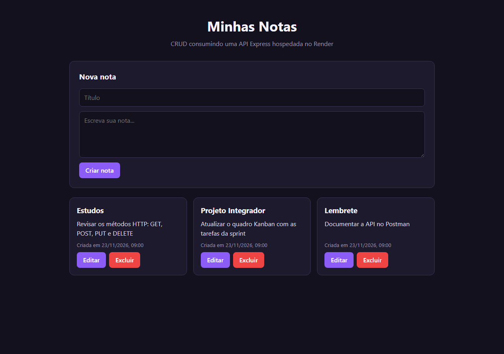
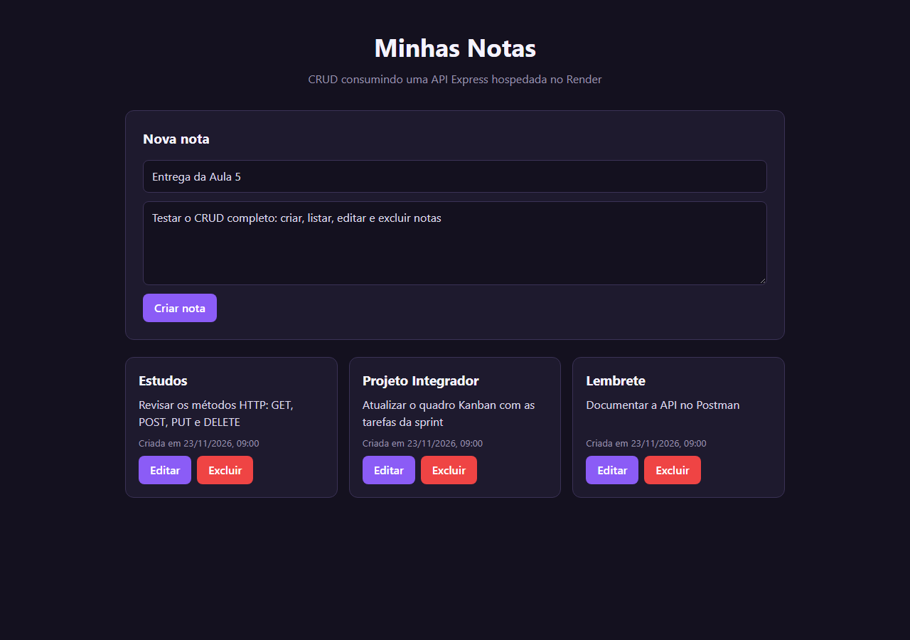
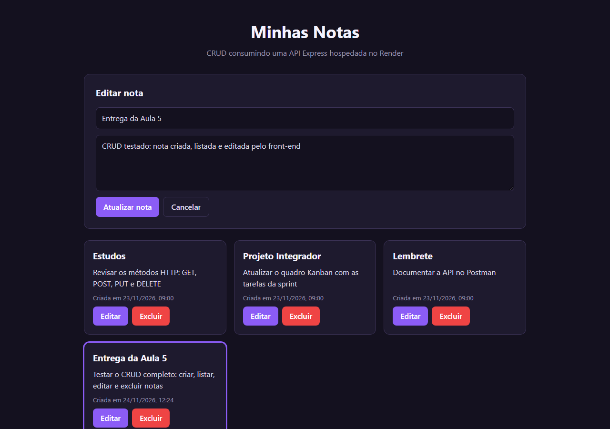
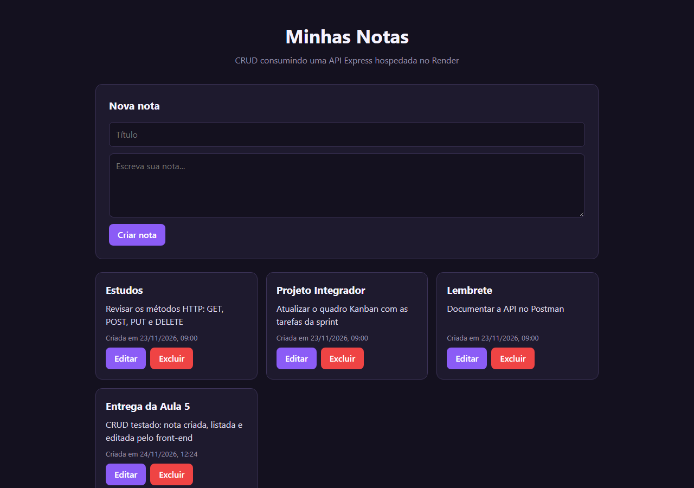
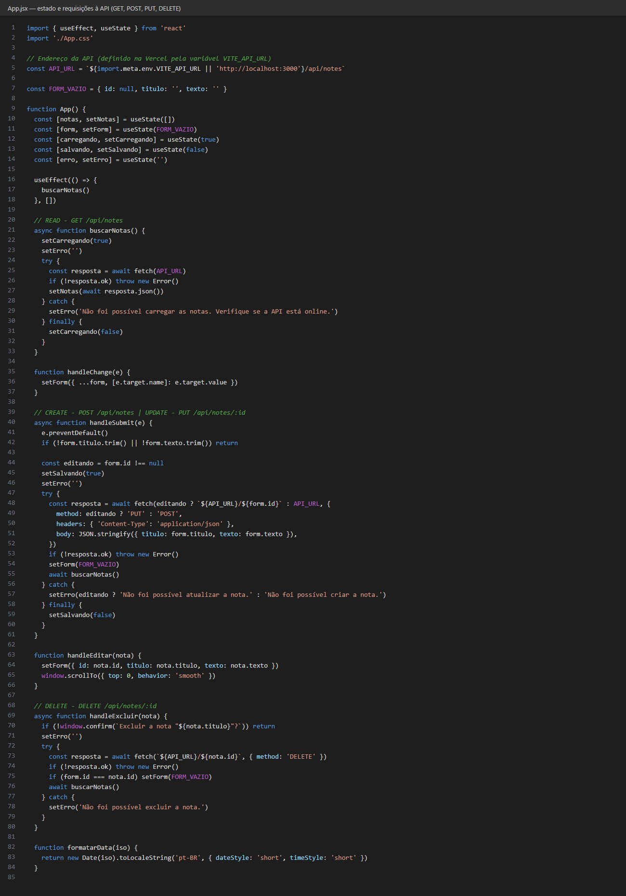

# Minhas Notas — Front-end (Aula 05)

Aplicação front-end em **React + Vite** desenvolvida para a Atividade 02 da Aula 05 da disciplina **Frameworks Front-end (SENAI)**.

Ela consome a [API de Notas](https://github.com/liviaghirardi/api-notas-backend) hospedada no Render e permite realizar todas as operações CRUD.

- **Deploy (Vercel):** https://api-notas-frontend-bay.vercel.app
- **API (Render):** https://api-notas-backend-qp4b.onrender.com

## Prints da aplicação em funcionamento

| | |
|---|---|
| **1. Listar** (`GET`)  | **2. Preencher o formulário**  |
| **3. Nota criada** (`POST`)  | **4. Editar**  |
| **5. Nota editada** (`PUT`)  | **6. Nota excluída** (`DELETE`)  |

### Código das requisições



## Funcionalidades

| Operação | O que o usuário faz | Requisição |
|----------|---------------------|------------|
| Criar | Preenche título e texto e clica em **Criar nota** | `POST /api/notes` |
| Visualizar | As notas aparecem ao abrir a página | `GET /api/notes` |
| Editar | Clica em **Editar**, altera e clica em **Atualizar nota** | `PUT /api/notes/:id` |
| Excluir | Clica em **Excluir** e confirma | `DELETE /api/notes/:id` |

Também mostra mensagens de carregamento e de erro caso a API esteja fora do ar.

## Conceitos utilizados

- `useState` para guardar as notas, o formulário e os estados de carregamento e erro
- `useEffect` para buscar as notas quando a página abre
- `fetch` com `async/await` para chamar a API
- Formulário controlado, reaproveitado para criar e editar
- Renderização condicional e listas com `map`
- Variável de ambiente `VITE_API_URL` com o endereço da API

## Como executar

```bash
npm install
npm run dev
```

Sem configuração, o front usa a API local em `http://localhost:3000`. Para usar a API do Render, crie um arquivo `.env`:

```
VITE_API_URL=https://endereco-da-api.onrender.com
```

## Deploy na Vercel

1. Importe este repositório na Vercel (framework detectado: **Vite**).
2. Em **Environment Variables**, adicione `VITE_API_URL` com o endereço da API no Render.
3. Clique em **Deploy**.
